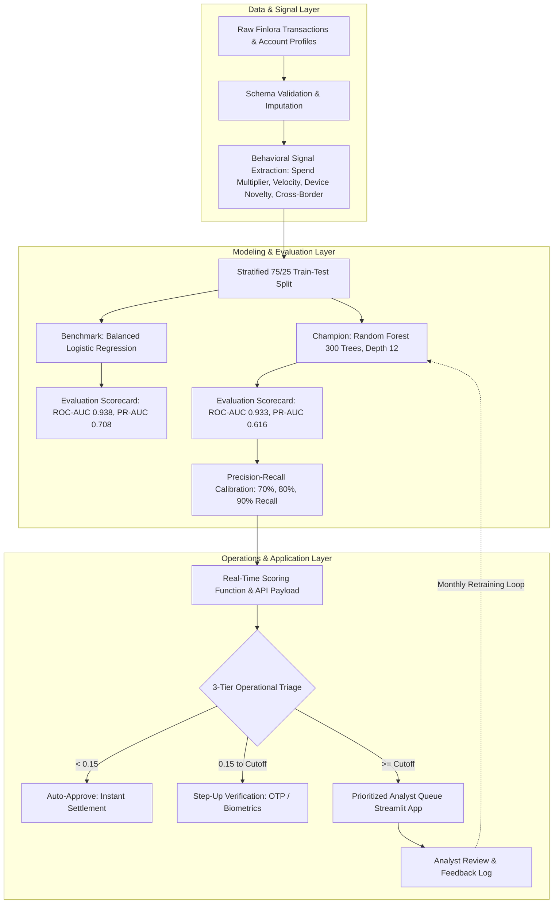

# Finlora Finance Flow

### Applied Machine Learning Transaction Risk Scoring & Fraud Detection Architecture

> **Data Source:** The dataset used in this project is synthetic, generated by `scripts/generate_raw_data.py` (NumPy random, seed 42). All results describe model behaviour on simulated data, not real-world fraud performance.

---

## Overview

Finlora Finance Flow ("Finlora") is a fictional fintech scenario developed as an Amdari applied data-science case study. In this scenario, Finlora represents a 24/7 financial platform providing payment processing, budgeting, and compliance services across distributed markets in Nigeria, the United States, and the United Kingdom.

Historically, transaction monitoring relied on rigid rules like fixed dollar cutoffs and blunt country bans. As payment volume grew, this static approach created three big headaches:

1. Too Many False Alarms: Rigid rules frequently blocked legitimate payroll runs, bank wires, and everyday payments. This annoyed good customers and overwhelmed the review team.
2. Sneaky Fraud Slipped Through: Clever fraudsters made small trial payments from new devices that easily flew under simple dollar limits.
3. No Way to Prioritise: Alerts arrived in a giant unordered pile, forcing investigators to inspect false alarms in the order they arrived rather than tackling genuine emergencies first.

This project delivers a machine learning risk-scoring system trained on 126,000 synthetic (simulated) transactions across 7,200 simulated account profiles. Instead of rigid yes/no rules, the engine calculates a continuous risk score from 0% (very safe) to 100% (almost certainly fraud). It benchmarks a simple Logistic Regression baseline against a smart Random Forest champion model, provides tunable alert settings (to catch 70%, 80%, or 90% of all fraud), and connects to an interactive Streamlit dashboard that clearly explains why each payment was flagged.

---

## System Architecture

The architecture connects three modular layers:



1. Data & Signal Layer:
   - Ingests customer account profiles (finlora_accounts.csv) and transaction logs (finlora_transactions.csv).
   - Audits missing information, flags customer refunds, and cleanly handles payment channels that do not use phones or computers.
   - Calculates key behavioral clues: spending spikes relative to normal averages, rapid bursts of transactions within an hour, unfamiliar devices, and international activity.
2. Modeling & Evaluation Layer:
   - Splits data fairly (75% for training, 25% kept hidden for testing) while keeping the 2.66% fraud rate in both sets.
   - Rescales numbers to a fair baseline and trains both a transparent Logistic Regression baseline model and a 300-tree Random Forest ensemble candidate.
   - Evaluates test accuracy, compares precision and false alarms to select the winning champion model, and tunes alert cutoffs to catch 70%, 80%, or 90% of all fraud.
3. Operations & Application Layer:
   - Automatically routes live payments into three clear buckets: Auto-Approve (about 79% of holdout transactions), Step-Up Verification (asking for a code or fingerprint), or Analyst Review Queue.
   - Feeds a live Streamlit review screen that sorts suspicious payments by risk so investigators handle the most dangerous cases first.
   - Displays clear, plain-English reasons for every flagged payment so analysts can make fast, confident decisions.

---

## Workflow and Notebooks

The end-to-end development workflow is organized into six sequential, fully executed Jupyter notebooks located in the `notebooks/` directory. Each notebook contains step-by-step explanations written in simple, clear English:

| Notebook | Focus | Primary Outputs |
| :--- | :--- | :--- |
| [01_data_cleaning.ipynb](notebooks/01_data_cleaning.ipynb) | Checking missing fields, fixing date formats, joining account profiles | data/processed/cleaned_transactions.csv (126,000 clean records) |
| [02_EDA.ipynb](notebooks/02_EDA.ipynb) | Fraud frequency, spending spikes, high-risk stores, and device checks | Discovered 2.66% fraud rate, spending habits, and high-risk store types |
| [03_feature_engineering.ipynb](notebooks/03_feature_engineering.ipynb) | Creating clues for models, scaling huge dollar values, removing private IDs | data/processed/feature_matrix.csv (126,000 rows x 50 columns) |
| [04_model_development.ipynb](notebooks/04_model_development.ipynb) | Fair 75/25 train-test split, number scaling, training baseline and Random Forest candidate models | Trained candidate artifacts in model/: logistic_regression_baseline.joblib, random_forest_model.joblib, scaler.joblib |
| [05_model_evaluation_and_thresholds.ipynb](notebooks/05_model_evaluation_and_thresholds.ipynb) | Testing on 31,500 new transactions, selecting winning champion model, tuning alert thresholds | model/random_forest_champion.joblib<br>model/evaluation_summary.json<br>data/processed/holdout_predictions.csv |
| [06_production_governance.ipynb](notebooks/06_production_governance.ipynb) | Live scoring function, 3-tier action buckets, system diagram, and retraining runbook | Instant payment scorer, triage logic, and ongoing maintenance rules |

---

## Key Findings from Exploratory Analysis

Analysing 126,000 synthetic transactions across 7,200 simulated account profiles revealed four clear patterns:

1. Fraud is Rare (2.66%): Only 3,352 out of 126,000 transactions were fraudulent (2.66%). If a system blindly guessed 'genuine' every time, it would look 97.34% accurate while missing every single fraud event. That is why models are evaluated on how much fraud they catch (Recall) and how few false alarms they raise (Precision), not simple overall accuracy.
2. Sudden Spending Spikes: Looking at dollar amounts alone is misleading—a $500 purchase might be completely routine for one customer and alarming for another. What matters is the sudden deviation: the median fraudulent transaction was 6.04x the customer's 30-day average, whereas the median genuine transaction was 0.95x.
3. Unrecognised Devices: New or unfamiliar devices accounted for 228 of 3,352 fraud transactions (6.8%) compared to 3,667 of 122,648 genuine transactions (3.0%). Device novelty is roughly twice as common in fraud, making it a useful but not dominant signal.
4. High-Risk Channels and Stores:
   - Payment Channels: Automated system connections (API at 3.65%) and web browsers (2.96%) saw higher fraud rates than mobile apps (2.51%).
   - Store Categories: Wire transfers (7.58% fraud rate), payroll services (5.59%), and cryptocurrency exchanges (5.20%) experienced the highest rates of fraud.

---

## Model Benchmarking & Performance Evaluation

Both models were tested against 31,500 fresh transactions (including 838 fraud cases) that were kept strictly hidden during training.

### Model Performance Comparison

| Model | Architecture | ROC-AUC | PR-AUC | Default Precision | Default Recall | F1-Score | Role in System |
| :--- | :--- | :---: | :---: | :---: | :---: | :---: | :--- |
| Logistic Regression | Linear formula with balanced class weighting | 0.938 | 0.708 | 24.7% | 85.8% | 38.3% | Simple, fast baseline comparison |
| Random Forest | 300 decision trees voting together | 0.933 | 0.616 | 40.0% | 79.8% | 53.3% | Winning Champion; catches complex patterns with far fewer false alarms |

### Adjustable Alert Policies (Random Forest Champion)

Instead of relying on a rigid 50-50 guess, the team can adjust the alert threshold depending on how many investigators are available and how cautious the bank needs to be:

| Operating Policy | Risk Score Cutoff | Fraud Caught (Recall) | Alert Accuracy (Precision) | Review Queue Size | Alert Rate (% of Traffic) | Best Use Case |
| :--- | :---: | :---: | :---: | :---: | :---: | :--- |
| Conservative Policy | 0.7048 | 70.05% | 61.02% | 962 | 3.05% | Smaller teams; catches 70% of fraud with very few false alarms |
| Balanced Policy (Recommended) | 0.4884 | 79.95% | 39.34% | 1,703 | 5.41% | Best everyday balance; catches 80% of fraud while keeping review workloads manageable |
| Aggressive Policy | 0.1616 | 89.98% | 12.86% | 5,865 | 18.62% | Maximum security; catches 90% of fraud during coordinated scam attacks (creates a larger review queue) |

### Most Important Fraud Clues

The winning Random Forest model relies most heavily on these practical behavioral signals (Gini importance on the trained champion):
- Transaction Rush (`transaction_velocity_1h`): 35.83% relative contribution. Multiple payments sent in rapid succession within the last hour.
- Spending Jump, log scale (`log_amount_to_avg_ratio`): 19.16% relative contribution. How many times higher the purchase is compared to the customer's 30-day average.
- Spending Jump (`amount_to_avg_ratio`): 17.12% relative contribution.
- Purchase Amount (`log_amount`): 6.07% relative contribution.
- Typical Spend (`log_avg_30d`): 4.45% relative contribution. The customer's usual 30-day average.

---

## Operational Triage & Analyst Review Dashboard

Every transaction is evaluated instantly and sorted into one of three action tiers:

- Low Risk (Score below 0.15): Auto-Approve. About 79% of holdout transactions go through immediately without interrupting the customer.
- Medium Risk (Score between 0.15 and Cutoff): Extra Verification (2FA). Prompts the customer with a one-time phone code or fingerprint check to confirm their identity.
- High Risk (Score at or above Cutoff): Investigator Review. Temporarily holds the transaction and sends it to the Streamlit dashboard for a human analyst to inspect.

### Streamlit Dashboard Features (app.py)

The web dashboard gives fraud analysts a clear workspace:
- Key Metrics at a Glance: Displays total transactions, active review cases, total dollars at risk, and alert accuracy.
- Policy Switcher: Lets team leads toggle between Conservative (70% caught), Balanced (80% caught), Aggressive (90% caught), or custom cutoff sliders.
- Prioritized Queue: Puts the most suspicious, highest-risk payments right at the top of the list.
- Case Inspector: Shows the exact reasons why a payment was flagged (for example a spending spike above the customer's 30-day average, an unknown phone, or rapid transactions).
- Interactive Risk Simulator: Lets investigators test hypothetical payment scenarios and get an instant risk score and recommended action.
- One-Click Decisions: Buttons to approve payments, request two-factor verification, or confirm fraud and lock compromised accounts.

---

## Production Governance and Monitoring

Rules to ensure the system stays accurate and reliable over time:

- Daily Alert Checks: The expected queue-alert band is 1.5% to 4.0% of payment volume. If more than 4.0% of payments are flagged in a single day, investigate coordinated attacks or technical glitches.
- Accuracy Tracking: Review analyst outcomes weekly. If confirmed fraud among alerts falls below 40%, recalibrate thresholds. The champion should also keep holdout ROC-AUC at or above 0.90.
- Monthly Model Updates: Retrain models on the 1st of every month using newly confirmed dispute data from the previous 30 days.
- Emergency Update Trigger: If the false-positive rate exceeds 15% for two weeks in a row, trigger an immediate out-of-cycle model update.

---

## Repository Structure

```
Fraud Detection & Risk Scoring/
├── README.md                                  # Complete project documentation and runbook
├── requirements.txt                           # Python project dependencies
├── app.py                                     # Interactive Streamlit analyst dashboard
├── scripts/
│   ├── generate_raw_data.py                   # Synthetic raw data generator (seed 42)
│   ├── run_all_notebooks.py                   # Automated notebook execution pipeline
│   ├── build_nb01.py                          # Notebook 01 builder script
│   ├── build_nb02.py                          # Notebook 02 builder script
│   ├── build_nb03.py                          # Notebook 03 builder script
│   ├── build_nb04.py                          # Notebook 04 builder script
│   ├── build_nb05.py                          # Notebook 05 builder script
│   └── build_nb06.py                          # Notebook 06 builder script
├── data/
│   ├── raw/
│   │   ├── finlora_accounts.csv               # 7,200 simulated account profile records
│   │   └── finlora_transactions.csv           # 126,000 synthetic transaction records
│   └── processed/
│       ├── cleaned_transactions.csv           # Merged, validated transaction dataset
│       ├── feature_matrix.csv                 # Feature-engineered matrix (126,000 x 50)
│       └── holdout_predictions.csv            # Test set predictions with risk scores
├── model/
│   ├── logistic_regression_baseline.joblib    # Trained Logistic Regression benchmark
│   ├── random_forest_champion.joblib          # Trained Random Forest classifier
│   ├── scaler.joblib                          # Standard scaler for numerical features
│   ├── feature_names.joblib                   # List of 33 model input feature names
│   └── evaluation_summary.json                # Complete metric scorecard and threshold points
└── notebooks/
    ├── 01_data_cleaning.ipynb                 # Data Cleaning & Schema Preparation
    ├── 02_EDA.ipynb                           # Exploratory Data Analysis & Profiling
    ├── 03_feature_engineering.ipynb           # Behavioral Signal Engineering
    ├── 04_model_development.ipynb             # Scikit-Learn Model Training
    ├── 05_model_evaluation_and_thresholds.ipynb # Evaluation & Threshold Tuning
    └── 06_production_governance.ipynb         # Production Scoring & Governance
```

---

## Setup and Execution Guide

### Prerequisites

- Python 3.10, 3.11, 3.12, 3.13, or 3.14
- Recommended virtual environment: `venv` or `conda`

### Installation

```bash
# Clone the repository and navigate to the project directory
git clone https://github.com/earlchirchir/Fraud-Detection-Risk-Scoring.git
cd Fraud-Detection-Risk-Scoring

# Install project dependencies
pip install -r requirements.txt
```

### Running the Notebooks

The notebooks are designed to be executed sequentially in Jupyter or VS Code:

```bash
jupyter notebook notebooks/01_data_cleaning.ipynb
```

To run all six notebooks programmatically and refresh all outputs:

```bash
python scripts/run_all_notebooks.py
```

### Launching the Streamlit Command Center

Launch the interactive analyst review queue dashboard locally:

```bash
streamlit run app.py
```

The application opens in the default web browser at `http://localhost:8501`.
